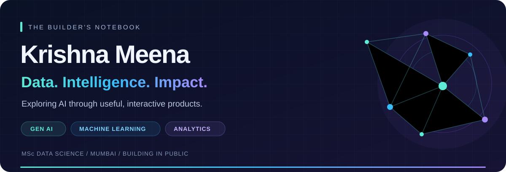
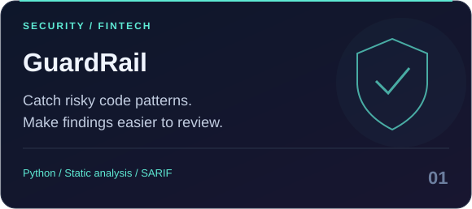
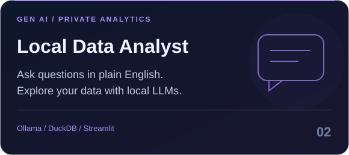
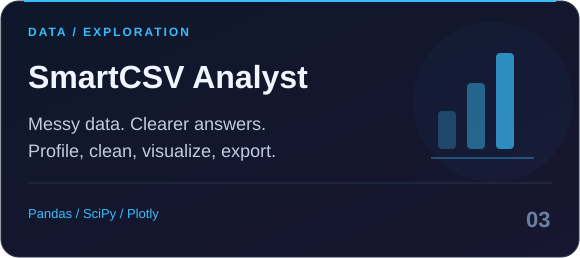
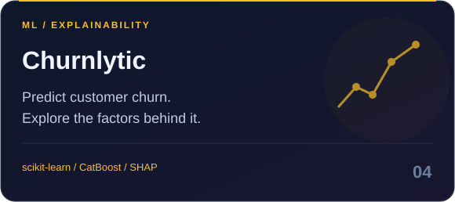

  

  <b>MSc Data Science student · Mumbai · Building practical AI and data products</b>

  <a href="https://github.com/Krishna-Meena/guard-rail">Explore GuardRail</a> &nbsp;·&nbsp;
  <a href="https://github.com/Krishna-Meena?tab=repositories">Browse my projects</a> &nbsp;·&nbsp;
  <a href="mailto:student.krishnameena@gmail.com">Let's connect</a>

---

### A little context behind the code

I'm Krishna, a Data Science student exploring how **GenAI, machine learning, and analytics** can make complex work easier. My projects span natural-language data analysis, financial market experiments, customer churn, and security tooling for financial-services code.

**My direction:** GenAI / LLM engineering and data roles, with a particular interest in **BFSI and FinTech**.

### Selected builds

<table>
<tr>
<td width="50%" valign="top">

#### 01 / GuardRail
**Security tooling for financial-services code**

A static scanner that flags risky code patterns and maps findings to security and compliance references. Includes a CLI, Streamlit dashboard, and SARIF reporting.

Python · Static analysis · Streamlit · SARIF

**[Explore the code →](https://github.com/Krishna-Meena/guard-rail)** &nbsp; [Live demo ↗](https://guard-rail.streamlit.app)

</td>
<td width="50%" valign="top">

#### 02 / Local Data Analyst
**Ask your data. Keep it local.**

An LLM-powered analysis workspace for profiling datasets, asking questions in plain English, generating DuckDB SQL, and exporting reports with local Ollama inference.

Python · Ollama · DuckDB · Streamlit · Plotly

**[Explore the code →](https://github.com/Krishna-Meena/LLM-Driven-Data-Analyst-Assistant)**

</td>
</tr>
<tr>
<td width="50%" valign="top">

#### 03 / SmartCSV Analyst
**From messy CSVs to clearer insights**

An interactive exploration app with statistical profiling, data quality checks, cleaning tools, automated insights, and downloadable results.

Python · Pandas · SciPy · Plotly · Streamlit

**[Explore the code →](https://github.com/Krishna-Meena/smartcsv-analyst)** &nbsp; [Live demo ↗](https://smartcsv-analyst-v2.streamlit.app/)

</td>
<td width="50%" valign="top">

#### 04 / Churnlytic
**Understand who might leave — and why**

A customer churn project combining model comparison, single and batch predictions, interactive diagnostics, and SHAP explanations.

scikit-learn · CatBoost · XGBoost · SHAP

**[Explore the code →](https://github.com/Krishna-Meena/Chrunpredication)**

</td>
</tr>
</table>

**Also exploring:** [AI-Driven Candlestick Prediction →](https://github.com/Krishna-Meena/ai-driven-candle-stick-prediction)  
Market data, technical indicators, classification models, and strategy backtesting through Streamlit, FastAPI, and a CLI.

### My project toolkit

### What I'm sharpening next

- **LLM engineering:** retrieval-augmented generation, evaluation, and reliable tool use.
- **Data foundations:** Python problem solving, SQL, statistics, and model evaluation.
- **Software quality:** readable architecture, meaningful tests, typed interfaces, and reproducible environments.

---

<b>Have an internship, a useful problem, or an idea worth building?</b> 
<a href="mailto:student.krishnameena@gmail.com">student.krishnameena@gmail.com</a>  
Learning deeply. Building deliberately. Sharing the work.

